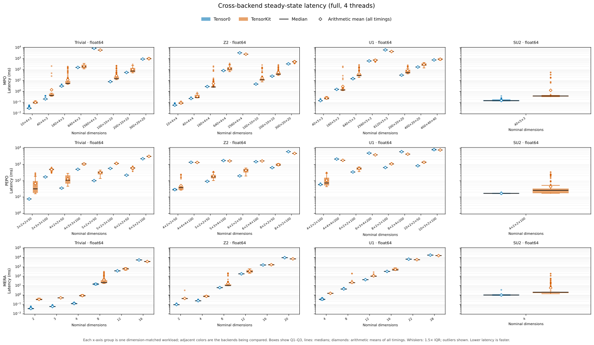

# Full Cross-Backend CPU — 4 Workers

[All raw samples](results.json) · [Latency distributions](latency.svg) · [Shared sampling plan](../sampling-plan.json) · [Overview](../report.md)

**69 workloads (66 reference dimension cases + 3 nonuniform SU2 extensions), same committed source and native build at 1/4/8t.** Equal-workload geometric mean TK/T0 latency ratios: **median 1.645×; mean 1.968×**. Values >1 favor Tensor0. These are workload-weighted descriptive ratios, not total time, throughput or significance.

| Round (zero-based) | Tensor0 lower median | Geometric mean TK/T0 |
| --- | ---: | ---: |
| 0 | 55/69 | 1.705× |
| 1 | 51/69 | 1.615× |
| 2 | 53/69 | 1.685× |

Observed direction reversals: **4/69**, flagged below; raw within-round medians, pooled min/median/inclusive IQR/max and all samples are in JSON. No observed reversal is not a claim of significance or future stability.

## Identity, resources and measurement

- Source `387b2b8c4eeebeb092a96158236315cc2e8a1129`, committed archive, all 160 production file hashes verified. Fresh release native SHA256 `a5e0c34f4179a94e8a8552a16441237c9dc81a68b7e9c8e06f30b4440d017638`. As-run public runner unchanged; no dirty production, GEMM strategy edits or benchmark patches. Rust 1.89/GCC 15.3/maturin 1.13.1; approved offline dependencies unchanged. GCC 15 g++ linker; `RUSTFLAGS="-C link-arg=-lstdc++ -C link-arg=-lgcc"` and final root-crate flags `-C link-arg=-Wl,--no-as-needed -C link-arg=-Wl,--undefined=__cpu_features2 -C link-arg=-lstdc++ -C link-arg=-lgcc`; no LD_PRELOAD. Distribution 0.1.0 still exports literal 0.0.0 runtime version in this source; the commit/hash, not that exported string, identifies the build.
- Python 3.14.6, JAX/JAXlib 0.10.1, NumPy 2.4.6; Julia 1.12.5, TensorKit 0.16.5, TensorOperations 5.6.1, Strided 2.5.0. Actual Julia BLAS configuration `LBTConfig([ILP64] libopenblas64_.so)`; library hashes retained in JSON.
- Slurm node **n002**, E5-2680v3 (Haswell-EP), 24 physical cores/two sockets, SMT off. Exclusive 24-core allocation, 104 GiB job memory on 128 GiB-class hardware with 20 GiB OS reservation. Measurement affinity **[0, 1, 2, 3]**, nested 1/4/8 same-socket distinct physical cores; monitor on CPU 8. Three sequential exclusive round jobs **993086, 993087, 993088**, thread order 1/4/8 then 4/8/1 then 8/1/4; backend/workload forward/reverse/forward. Allocation identities and gates checked each time.
- Before timing, independent pinned 4/8-process gates reached approximately 4/8 core-equivalents; native reduction and Julia/BLAS multiplication showed actual worker-thread CPU time with queried 4/8 limits. Gates finished before samples and prove usable resources/representative parallelism, not saturation of every workload. Queried runtime limits match every request.
- Per-workload mandatory first invocation + **two warmups**, then frozen **7–100 timed calls per round** according to the [shared plan](../sampling-plan.json), identical for both backends and all thread counts. Slowest of six complete preflight medians >=2s gets 7; other counts are clamp(ceil(2s/t_slow),15,100). The threshold selects a cost tier; the 2s numerator is a bounded target, not a guarantee of precision or sample duration. Preflight is separate (one round, 1/3 timed calls by risk), never pooled with formal samples. Counts are not adapted to speedup, winners or observed formal results.
- Prepared contraction execution and completion are timed. Inputs, planning, compilation, mandatory call and warmups are outside timing; scalar validation reuses the final timed output without extra contractions. Natural GC tails are retained: no sample filtering or selective reruns. The [pinned upstream network-comparison script](https://github.com/QuantumKitHub/TensorKit.jl/blob/cfaa073e4d1e3eb2167edcbdc3be9872f41e7d91/benchmark/comparisons/run_tensorkit.jl) instead sets **K=100** outer samples, with [one initial compilation call, inner=1](https://github.com/QuantumKitHub/TensorKit.jl/blob/cfaa073e4d1e3eb2167edcbdc3be9872f41e7d91/benchmark/comparisons/benchtools.jl), reports averages and separately records GC time. We add two explicit warmups, use fixed 7–100 repeats per round and three paired rounds, report pooled medians (now supplemented by derived unfiltered means), and retain GC in wall samples without subtracting it. Thus heavy cases have 21 rather than 100 timed calls, and 100-repeat cases have 300 across three processes, not an identical sampling policy. The separate upstream BenchmarkTools suite (20s/10000-sample limits) is not that network-comparison script.
- **138 aggregate records, 207 per-round scalar pairs, 16,290 raw samples passed**, including basis-sensitive nonuniform SU2, unchanged component-wise rtol=atol=1e-9. Maximum aggregate relative error 4.01e-10. Sample counts, hashes, original round indices and pooled statistics checked exactly. Fresh native regressions 142 passed; benchmark tests 48 passed.

## Monitoring and limitations

Continuous 2s process/thread CPU, RSS, cgroup quota/throttle, per-core busy/steal, frequency and process observations ran off target cores. Peak sampled process RSS **38.00 GiB**; no memory/timeout guard fired. Observed CPU quota unlimited, maximum throttle-counter delta **0**, steal ticks **0** across allocated cores. Frequency snapshots **2.80–3.30 GHz**, not locked; no governor changed. Exclusive Slurm placement does not eliminate OS activity, thermal behavior or cache/history differences across allocations.

Measurement interval: **2026-10-10T20:55:43.061871+00:00–2026-10-11T04:48:18.380494+00:00**. Job cgroup high-water memory observed during these intervals: **40.47 GiB** (the counter may include earlier thread configurations in the same allocation).

Preparation failures occurred before formal sampling. The three formal jobs used immutable scripts and all completed successfully; no formal sample was omitted or replaced. Detailed preparation diagnostics are retained privately.

Backend-process wall total **2.48h**, timed samples **1.27h**, remainder **1.21h** (startup, input/setup, planning/compilation, mandatory call, warmups, validation and teardown). Unchanged adapters do not expose separate compile versus input/setup timers; the remainder is not a compile-only measurement. Process CPU/wall and core busy fractions likewise include untimed work, not steady-kernel occupancy.

Same-version scaling in the [overview](../report.md) is descriptive: different thread counts are measured sequentially, and allocation boundaries remain a limitation. Medians alone are not confidence intervals or a general framework ranking. Larger thread budgets can hurt small or memory-bound cases.

## Reproduction

On equivalent approved dependencies, build this committed revision in release mode. Under an exclusive Slurm allocation with >=96 GiB plus margin and >=8 distinct same-socket cores, first verify quota/topology and bounded independent/native/BLAS gates. Use your allocation's CPU IDs:

```sh
taskset -c 0,1,2,3 python -m benchmarks.cross_backend \
  --profile full --threads 4 --warmup 2 --repeat 7 --rounds 3 \
  --sampling-plan benchmarks/cross_backend/results/sampling-plan.json \
  --json-output results.json --markdown report.md --plot latency.svg
```

This public CLI preserves the measurement contract but runs one thread configuration at a time; the retained run interleaved configurations by true round as described above. The shared plan SHA256 is `e8879fce6ef36c9bbe547b015e4a69d25deab49beb670f354d5357b10e6acd91`. Auxiliary private paths are omitted; raw numeric fields/scalars are unchanged.

## Per-workload pooled latency and round ratios

Median / mean values are milliseconds; means include all recorded timings without filtering.
Repeat is per backend/round (three rounds); all records and scalar comparisons passed validation.
Ratios are TK/T0; r0/r1/r2 are paired within-round **median** ratios. `*` marks ratios on both sides of 1, not a confidence interval.
Pooled min/median/inclusive IQR/max, exact sample counts and all samples remain in [JSON](results.json).

Adjacent colored boxes compare Tensor0 and TensorKit for each workload. Rows are MPO/PEPO/MERA; columns are Trivial/Z2/U1/SU2, with the original dtype and dimension labels. The logarithmic latency axis is in milliseconds (lower is faster). Boxes show Q1–Q3 with median lines; whiskers use 1.5× IQR and all outliers remain visible. Open diamonds show the arithmetic mean of all recorded timings, without filtering. The median remains the primary distribution summary; the mean describes tails, not throughput or GC causality.



### MPO

| Workload | Repeat | T0 median / mean ms | TK median / mean ms | Median ratio | Mean ratio | r0 / r1 / r2 |
| --- | ---: | ---: | ---: | ---: | ---: | --- |
| `tensor_networks.mpo.trivial.float64.d10x4x3` | 100 | 0.029092 / 0.029995 | 0.090863 / 0.100000 | 3.123 | 3.334 | 2.953 / 4.353 / 3.097 |
| `tensor_networks.mpo.trivial.float64.d40x4x3` | 100 | 0.202764 / 0.208921 | 0.431121 / 1.427005 | 2.126 | 6.830 | 2.008 / 2.956 / 2.087 |
| `tensor_networks.mpo.trivial.float64.d160x4x3` | 100 | 3.060128 / 3.106457 | 5.461793 / 11.764801 | 1.785 | 3.787 | 2.653 / 1.575 / 2.491 |
| `tensor_networks.mpo.trivial.float64.d640x4x3` | 15 | 157.877336 / 158.346979 | 181.533327 / 212.299045 | 1.150 | 1.341 | 1.340 / 1.039 / 1.150 |
| `tensor_networks.mpo.trivial.float64.d2560x4x3` | 7 | 8951.315754 / 8879.146549 | 6060.764730 / 6116.043659 | 0.677 | 0.689 | 0.675 / 0.720 / 0.673 |
| `tensor_networks.mpo.trivial.float64.d100x10x10` | 67 | 7.878620 / 7.918172 | 14.649167 / 27.269399 | 1.859 | 3.444 | 2.224 / 1.841 / 2.094 |
| `tensor_networks.mpo.trivial.float64.d200x10x10` | 15 | 55.136181 / 55.111306 | 73.257141 / 102.915334 | 1.329 | 1.867 | 1.706 / 1.180 / 1.992 |
| `tensor_networks.mpo.trivial.float64.d300x20x20` | 7 | 921.501989 / 920.800579 | 1011.044519 / 1015.731299 | 1.097 | 1.103 | 1.108 / 1.154 / 1.060 |
| `tensor_networks.mpo.z2.float64.d10x4x4` | 100 | 0.055180 / 0.056817 | 0.084661 / 0.087838 | 1.534 | 1.546 | 1.447 / 1.789 / 1.532 |
| `tensor_networks.mpo.z2.float64.d40x4x4` | 100 | 0.226909 / 0.229404 | 0.283176 / 0.354093 | 1.248 | 1.544 | 1.204 / 2.121 / 1.256 |
| `tensor_networks.mpo.z2.float64.d160x4x4` | 100 | 2.801463 / 2.819338 | 2.565959 / 5.358072 | 0.916 | 1.900 | 0.923 / 0.889 / 0.937 |
| `tensor_networks.mpo.z2.float64.d640x4x4` | 15 | 80.802404 / 81.096069 | 114.760340 / 137.310455 | 1.420 | 1.693 | 1.644 / 0.973 / 1.546 * |
| `tensor_networks.mpo.z2.float64.d2560x4x4` | 7 | 3400.557829 / 3397.585236 | 2542.422193 / 2569.134601 | 0.748 | 0.756 | 0.741 / 0.798 / 0.736 |
| `tensor_networks.mpo.z2.float64.d100x10x10` | 100 | 4.701956 / 4.748128 | 11.901437 / 16.815126 | 2.531 | 3.541 | 2.838 / 2.359 / 2.521 |
| `tensor_networks.mpo.z2.float64.d200x10x10` | 33 | 25.391409 / 25.146419 | 37.790753 / 56.028778 | 1.488 | 2.228 | 1.461 / 1.368 / 1.685 |
| `tensor_networks.mpo.z2.float64.d300x20x20` | 15 | 335.295726 / 337.224417 | 531.038312 / 516.166909 | 1.584 | 1.531 | 1.561 / 1.477 / 1.649 |
| `tensor_networks.mpo.u1.float64.d40x5x3` | 100 | 0.144620 / 0.146139 | 0.218748 / 0.245435 | 1.513 | 1.679 | 1.485 / 2.108 / 1.472 |
| `tensor_networks.mpo.u1.float64.d160x5x3` | 100 | 1.573703 / 1.560455 | 1.364014 / 2.880506 | 0.867 | 1.846 | 1.077 / 0.955 / 0.840 * |
| `tensor_networks.mpo.u1.float64.d640x5x3` | 63 | 14.883084 / 14.751790 | 28.096739 / 40.575860 | 1.888 | 2.751 | 2.459 / 1.805 / 2.139 |
| `tensor_networks.mpo.u1.float64.d2560x5x3` | 15 | 615.455821 / 621.216503 | 738.909204 / 729.018914 | 1.201 | 1.174 | 1.211 / 1.092 / 1.264 |
| `tensor_networks.mpo.u1.float64.d6120x5x3` | 7 | 6290.524689 / 6307.435243 | 4464.260513 / 4508.381024 | 0.710 | 0.715 | 0.709 / 0.741 / 0.705 |
| `tensor_networks.mpo.u1.float64.d200x20x20` | 15 | 31.341218 / 31.371447 | 51.994108 / 80.532593 | 1.659 | 2.567 | 1.861 / 1.528 / 1.867 |
| `tensor_networks.mpo.u1.float64.d400x20x20` | 15 | 172.511980 / 172.368686 | 270.601434 / 292.735424 | 1.569 | 1.698 | 1.857 / 1.371 / 1.894 |
| `tensor_networks.mpo.u1.float64.d400x40x40` | 15 | 764.182791 / 766.297069 | 908.413589 / 896.522567 | 1.189 | 1.170 | 1.164 / 1.220 / 1.114 |
| `tensor_networks.mpo.su2.float64.d40x5x3` | 100 | 0.144620 / 0.149783 | 0.388065 / 1.279220 | 2.683 | 8.540 | 2.799 / 2.582 / 2.537 |
### PEPO

| Workload | Repeat | T0 median / mean ms | TK median / mean ms | Median ratio | Mean ratio | r0 / r1 / r2 |
| --- | ---: | ---: | ---: | ---: | ---: | --- |
| `tensor_networks.pepo.trivial.float64.d3x2x2x50` | 16 | 7.601461 / 7.600726 | 31.938801 / 67.560438 | 4.202 | 8.889 | 4.465 / 2.441 / 4.174 |
| `tensor_networks.pepo.trivial.float64.d3x3x3x100` | 15 | 171.058590 / 171.185571 | 500.706740 / 485.194330 | 2.927 | 2.834 | 2.967 / 2.440 / 2.927 |
| `tensor_networks.pepo.trivial.float64.d4x2x2x50` | 15 | 35.144647 / 35.160445 | 107.600430 / 129.511635 | 3.062 | 3.683 | 3.177 / 1.935 / 3.132 |
| `tensor_networks.pepo.trivial.float64.d4x3x3x100` | 7 | 503.849619 / 504.544549 | 1089.440887 / 1074.983040 | 2.162 | 2.131 | 2.151 / 2.219 / 2.113 |
| `tensor_networks.pepo.trivial.float64.d5x2x2x50` | 15 | 101.498538 / 101.392360 | 323.176819 / 310.547512 | 3.184 | 3.063 | 3.308 / 2.605 / 3.055 |
| `tensor_networks.pepo.trivial.float64.d5x2x3x100` | 7 | 572.762869 / 572.012708 | 1147.980364 / 1156.822295 | 2.004 | 2.022 | 2.015 / 2.135 / 1.986 |
| `tensor_networks.pepo.trivial.float64.d6x2x2x50` | 15 | 219.668381 / 219.536710 | 606.864808 / 598.253427 | 2.763 | 2.725 | 2.812 / 2.762 / 2.726 |
| `tensor_networks.pepo.trivial.float64.d6x3x2x100` | 7 | 2237.475902 / 2236.479875 | 3126.073773 / 3146.878442 | 1.397 | 1.407 | 1.394 / 1.473 / 1.367 |
| `tensor_networks.pepo.z2.float64.d4x2x2x50` | 31 | 27.386492 / 28.606271 | 38.127283 / 50.024442 | 1.392 | 1.749 | 1.253 / 1.378 / 1.424 |
| `tensor_networks.pepo.z2.float64.d4x4x4x100` | 7 | 1354.794716 / 1354.293181 | 1318.487332 / 1331.184012 | 0.973 | 0.983 | 0.978 / 0.976 / 0.974 |
| `tensor_networks.pepo.z2.float64.d5x2x2x50` | 15 | 92.235040 / 92.245510 | 172.411553 / 194.629945 | 1.869 | 2.110 | 2.066 / 1.526 / 1.971 |
| `tensor_networks.pepo.z2.float64.d5x3x4x100` | 7 | 1729.481829 / 1729.833112 | 1638.114751 / 1637.009904 | 0.947 | 0.946 | 0.945 / 0.967 / 0.908 |
| `tensor_networks.pepo.z2.float64.d6x2x2x50` | 15 | 198.498854 / 198.888370 | 451.830814 / 429.512095 | 2.276 | 2.160 | 2.557 / 1.717 / 2.278 |
| `tensor_networks.pepo.z2.float64.d6x2x4x100` | 7 | 1484.235990 / 1483.871523 | 1643.066173 / 1629.268180 | 1.107 | 1.098 | 1.089 / 1.111 / 1.093 |
| `tensor_networks.pepo.z2.float64.d8x2x2x50` | 15 | 636.977732 / 637.196527 | 928.506205 / 969.766339 | 1.458 | 1.522 | 1.633 / 1.384 / 1.552 |
| `tensor_networks.pepo.z2.float64.d8x3x2x100` | 7 | 6126.886456 / 6124.273661 | 4797.759572 / 4790.912956 | 0.783 | 0.782 | 0.763 / 0.795 / 0.788 |
| `tensor_networks.pepo.u1.float64.d4x2x2x100` | 22 | 56.923675 / 58.399511 | 72.821728 / 107.696960 | 1.279 | 1.844 | 1.404 / 0.953 / 1.262 * |
| `tensor_networks.pepo.u1.float64.d4x4x4x200` | 7 | 2107.081493 / 2144.037211 | 1780.637525 / 1794.752997 | 0.845 | 0.837 | 0.871 / 0.792 / 0.842 |
| `tensor_networks.pepo.u1.float64.d6x2x2x100` | 15 | 344.783048 / 345.275840 | 580.430034 / 555.320983 | 1.683 | 1.608 | 1.741 / 1.474 / 1.722 |
| `tensor_networks.pepo.u1.float64.d6x3x4x200` | 7 | 4900.524101 / 4951.513276 | 3867.845459 / 3873.963011 | 0.789 | 0.782 | 0.785 / 0.764 / 0.796 |
| `tensor_networks.pepo.u1.float64.d8x2x2x100` | 15 | 646.803390 / 646.948890 | 1084.815648 / 1079.696171 | 1.677 | 1.669 | 1.683 / 1.619 / 1.693 |
| `tensor_networks.pepo.u1.float64.d8x2x4x200` | 7 | 5998.795123 / 6030.708504 | 4302.324289 / 4298.421809 | 0.717 | 0.713 | 0.703 / 0.721 / 0.718 |
| `tensor_networks.pepo.u1.float64.d10x2x2x50` | 15 | 830.093990 / 830.231799 | 1369.549886 / 1364.551342 | 1.650 | 1.644 | 1.649 / 1.665 / 1.675 |
| `tensor_networks.pepo.u1.float64.d10x3x2x100` | 7 | 8237.144122 / 8113.833909 | 7723.798425 / 7740.991200 | 0.938 | 0.954 | 1.016 / 0.926 / 0.937 * |
| `tensor_networks.pepo.su2.float64.d4x2x2x100` | 61 | 16.726735 / 16.747417 | 25.811265 / 43.066681 | 1.543 | 2.572 | 1.530 / 1.657 / 1.552 |
### MERA

| Workload | Repeat | T0 median / mean ms | TK median / mean ms | Median ratio | Mean ratio | r0 / r1 / r2 |
| --- | ---: | ---: | ---: | ---: | ---: | --- |
| `tensor_networks.mera.trivial.float64.d2` | 100 | 0.036377 / 0.036975 | 0.328855 / 0.349586 | 9.040 | 9.455 | 8.858 / 11.433 / 8.908 |
| `tensor_networks.mera.trivial.float64.d3` | 100 | 0.059276 / 0.060389 | 0.503999 / 0.506825 | 8.503 | 8.393 | 8.410 / 8.701 / 8.514 |
| `tensor_networks.mera.trivial.float64.d4` | 100 | 0.120210 / 0.125309 | 0.849615 / 0.864122 | 7.068 | 6.896 | 6.534 / 7.965 / 7.093 |
| `tensor_networks.mera.trivial.float64.d8` | 54 | 15.275151 / 14.642362 | 21.251382 / 40.405131 | 1.391 | 2.759 | 1.800 / 1.293 / 1.669 |
| `tensor_networks.mera.trivial.float64.d12` | 15 | 377.010392 / 378.740193 | 637.454131 / 616.383568 | 1.691 | 1.627 | 1.747 / 1.635 / 1.692 |
| `tensor_networks.mera.trivial.float64.d16` | 7 | 5403.716347 / 5432.692047 | 3764.048452 / 3733.780489 | 0.697 | 0.687 | 0.673 / 0.687 / 0.712 |
| `tensor_networks.mera.z2.float64.d2` | 100 | 0.095293 / 0.097400 | 0.426519 / 0.438642 | 4.476 | 4.504 | 4.362 / 4.511 / 4.566 |
| `tensor_networks.mera.z2.float64.d4` | 100 | 0.245583 / 0.250454 | 0.724589 / 0.738778 | 2.950 | 2.950 | 2.720 / 3.339 / 2.931 |
| `tensor_networks.mera.z2.float64.d8` | 100 | 6.128350 / 6.171683 | 10.296011 / 16.807665 | 1.680 | 2.723 | 1.693 / 1.668 / 1.667 |
| `tensor_networks.mera.z2.float64.d12` | 15 | 180.827340 / 180.720158 | 325.025489 / 354.908391 | 1.797 | 1.964 | 1.793 / 1.705 / 2.042 |
| `tensor_networks.mera.z2.float64.d16` | 7 | 1595.930763 / 1589.410777 | 1671.045036 / 1679.353496 | 1.047 | 1.057 | 1.033 / 1.032 / 1.108 |
| `tensor_networks.mera.z2.float64.d20` | 7 | 9547.385893 / 9546.498079 | 7167.613494 / 7167.418524 | 0.751 | 0.751 | 0.758 / 0.742 / 0.748 |
| `tensor_networks.mera.u1.float64.d4` | 100 | 0.346394 / 0.355251 | 1.524370 / 1.528585 | 4.401 | 4.303 | 4.531 / 4.312 / 4.241 |
| `tensor_networks.mera.u1.float64.d8` | 95 | 4.366843 / 4.478832 | 20.741533 / 21.972876 | 4.750 | 4.906 | 4.906 / 4.812 / 4.487 |
| `tensor_networks.mera.u1.float64.d12` | 18 | 43.249136 / 43.269302 | 101.727577 / 110.400103 | 2.352 | 2.551 | 2.333 / 2.429 / 2.300 |
| `tensor_networks.mera.u1.float64.d16` | 15 | 332.043200 / 331.625213 | 469.426596 / 549.135039 | 1.414 | 1.656 | 1.396 / 1.725 / 1.359 |
| `tensor_networks.mera.u1.float64.d22` | 7 | 6595.144716 / 6591.814710 | 5812.772251 / 5844.237421 | 0.881 | 0.887 | 0.900 / 0.893 / 0.890 |
| `tensor_networks.mera.u1.float64.d28` | 7 | 17867.890120 / 17896.166931 | 15768.695631 / 15633.339032 | 0.883 | 0.874 | 0.883 / 0.850 / 0.891 |
| `tensor_networks.mera.su2.float64.d4` | 100 | 1.003045 / 1.014921 | 2.004098 / 5.767814 | 1.998 | 5.683 | 2.010 / 1.671 / 2.010 |
