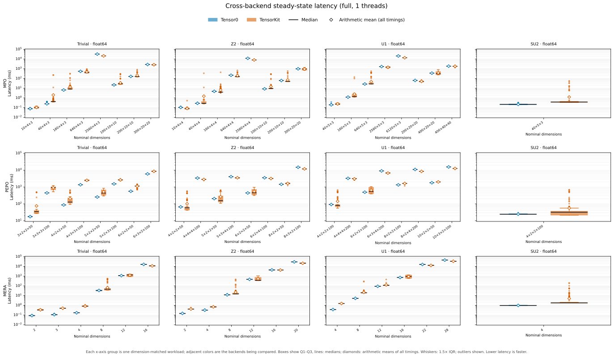
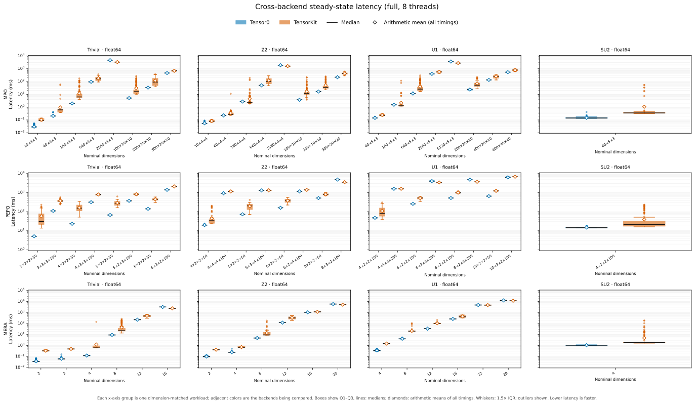

# Full Cross-Backend CPU Results

**69 workloads: 66 reference dimension cases + 3 basis-sensitive nonuniform SU2 extensions.** All retained 1/4/8-worker configurations use committed `387b2b8c4eeebeb092a96158236315cc2e8a1129` and the same fresh release native build (`a5e0c34f4179a94e8a8552a16441237c9dc81a68b7e9c8e06f30b4440d017638`), the same backend versions and one frozen [shared sampling plan](sampling-plan.json).

Measurements ran on exclusive Slurm node **n002**, Xeon E5-2680v3 (24 physical cores, two sockets, SMT off), with nested same-socket 1/4/8-core affinities. Each configuration passed 138 records and 207 per-round scalar comparisons (rtol=atol=1e-9); all 16,290 samples per configuration are retained.

| Workers | Geomean median TK/T0 | Geomean mean TK/T0 | Details |
| --- | ---: | ---: | --- |
| 1 | 1.185× | 1.465× | [Report](cpu-1t/report.md) · [JSON](cpu-1t/results.json) · [Distributions](cpu-1t/latency.svg) |
| 4 | 1.645× | 1.968× | [Report](cpu-4t/report.md) · [JSON](cpu-4t/results.json) · [Distributions](cpu-4t/latency.svg) |
| 8 | 1.918× | 2.257× | [Report](cpu-8t/report.md) · [JSON](cpu-8t/results.json) · [Distributions](cpu-8t/latency.svg) |

Ratios >1 favor Tensor0; <1 favor TensorKit. Each geometric mean gives equal weight to each workload's latency ratio: it does **not** represent total time, aggregate throughput or statistical significance. The arithmetic mean uses all samples (`math.fsum / count`), with no filtering, truncation or subtraction. It cannot identify the cause of slow calls. Round summaries and reversals are descriptive; no reversal is not proof of stability. Win counts are secondary diagnostics, not the headline.

### Secondary counts

| Workers | Lower median: T0 / TK | Lower mean: T0 / TK | Round median direction reversals |
| --- | ---: | ---: | ---: |
| 1 | 36 / 33 | 45 / 24 | 6/69 |
| 4 | 53 / 16 | 55 / 14 | 4/69 |
| 8 | 57 / 12 | 59 / 10 | 3/69 |

### All-workload latency distributions

Adjacent colored boxes compare Tensor0 and TensorKit for each workload. Rows are MPO/PEPO/MERA; columns are Trivial/Z2/U1/SU2, with the original dtype and dimension labels. The logarithmic latency axis is in milliseconds (lower is faster). Boxes show Q1–Q3 with median lines; whiskers use 1.5× IQR and all outliers remain visible. Open diamonds show the arithmetic mean of all recorded timings, without filtering. The median remains the primary distribution summary; the mean describes tails, not throughput or GC causality.

### Median/mean disagreements

All median/mean lower-latency direction disagreements are listed below (not selected examples):

| Workers | Workload | Median TK/T0 | Mean TK/T0 |
| --- | --- | ---: | ---: |
| 1 | `tensor_networks.mpo.trivial.float64.d200x10x10` | 0.953 | 1.313 |
| 1 | `tensor_networks.mpo.z2.float64.d40x4x4` | 0.986 | 5.419 |
| 1 | `tensor_networks.mpo.z2.float64.d160x4x4` | 0.853 | 1.341 |
| 1 | `tensor_networks.mpo.z2.float64.d200x10x10` | 0.796 | 1.168 |
| 1 | `tensor_networks.mpo.u1.float64.d400x20x20` | 0.881 | 1.052 |
| 1 | `tensor_networks.pepo.z2.float64.d4x2x2x50` | 0.889 | 1.535 |
| 1 | `tensor_networks.pepo.z2.float64.d5x2x2x50` | 0.757 | 1.277 |
| 1 | `tensor_networks.pepo.u1.float64.d4x2x2x100` | 0.876 | 1.550 |
| 1 | `tensor_networks.mera.z2.float64.d12` | 0.792 | 1.126 |
| 4 | `tensor_networks.mpo.z2.float64.d160x4x4` | 0.916 | 1.900 |
| 4 | `tensor_networks.mpo.u1.float64.d160x5x3` | 0.867 | 1.846 |
| 8 | `tensor_networks.mpo.z2.float64.d160x4x4` | 0.816 | 1.664 |
| 8 | `tensor_networks.mpo.u1.float64.d160x5x3` | 0.834 | 1.398 |

### Example: MPO Z2 d160×4×4

For this workload, TensorKit has lower pooled median latency but Tensor0 has lower unfiltered mean latency at all three thread budgets (ratios listed above). This is a neutral illustration of different summaries of the same formal samples, not a stability or significance result.

## Completed measurement and frozen sampling

All three configurations passed **138 aggregate records, 207 per-round scalar pairs and 16,290 raw samples each**: 414 aggregate records, 621 scalar pairs and 48,870 formal samples overall. The unchanged component-wise criterion is rtol=atol=1e-9, including nonuniform SU2. No timed sample was removed or filtered; natural GC tails are retained. Input preparation/planning/compilation, one mandatory invocation and two warmups are excluded; prepared execution/completion is timed. Correctness reuses the final timed scalar, with no additional contraction.

Counts were frozen before formal measurement from all six backend/thread preflight medians. Let t_slow be their maximum: if >=2s use 7 repeats/round; otherwise clamp(ceil(2s/t_slow),15,100). The 2s threshold is a cost tier; the numerator is a bounded target, not a precision/duration guarantee. Distribution **7 repeats: 20 workloads, 15 repeats: 21 workloads, 16 repeats: 1 workloads, 18 repeats: 1 workloads, 22 repeats: 1 workloads, 31 repeats: 1 workloads, 33 repeats: 1 workloads, 54 repeats: 1 workloads, 61 repeats: 1 workloads, 63 repeats: 1 workloads, 67 repeats: 1 workloads, 95 repeats: 1 workloads, 100 repeats: 18 workloads**. Three independent paired process rounds use identical counts for both backends and all thread counts, with no online adaptation to wins or scaling. Preflight is separate, never pooled into formal samples.

The pinned upstream TensorKit **network comparison** uses K=100 outer calls after one compilation call, inner=1, mean reporting and separate GC-time recording. Our explicit 2 warmups, 7–100 repeats/round × 3 processes, pooled medians (now supplemented by derived unfiltered means) and unfiltered wall samples are a different sampling policy. The separate upstream BenchmarkTools suite's 20s/10000-sample controls are not that network-comparison timer. See the pinned source links and reproduction commands in each report.

## Round results

Thread order is balanced: round 0 **1/4/8**, round 1 **4/8/1**, round 2 **8/1/4**; backend/workload order is forward/reverse/forward. Original zero-based round indices are retained in all JSON and checks.

| Workers | Round | T0 lower median | Geometric mean TK/T0 |
| --- | ---: | ---: | ---: |
| 1 | 0 | 38/69 | 1.192× |
| 1 | 1 | 38/69 | 1.198× |
| 1 | 2 | 38/69 | 1.179× |
| 4 | 0 | 55/69 | 1.705× |
| 4 | 1 | 51/69 | 1.615× |
| 4 | 2 | 53/69 | 1.685× |
| 8 | 0 | 56/69 | 1.975× |
| 8 | 1 | 56/69 | 1.913× |
| 8 | 2 | 57/69 | 1.950× |

## Same-version scaling (descriptive)

Geometric mean of lower-thread median / higher-thread median; parentheses count workloads faster with the higher thread budget. This does not use the superseded older-source medium1t snapshot.

| Backend | 1→4 | 1→8 | 4→8 |
| --- | ---: | ---: | ---: |
| tensor0 | 2.108× (67/69) | 2.809× (67/69) | 1.332× (64/69) |
| tensorkit | 1.518× (53/69) | 1.735× (61/69) | 1.143× (58/69) |

All measurements ran on exclusive Slurm **n002**, Xeon E5-2680v3 (Haswell-EP), 24 physical cores/two sockets, SMT off; 104 GiB requested on a 128 GiB-class node with 20 GiB OS reservation. Nested measurement affinities use 1/4/8 distinct physical cores on one socket; monitor CPU is separate. Each round is its own sequential exclusive allocation on that same node, with independent pinned-process throughput and bounded native/Julia/BLAS parallelism gates before timing. Actual worker limits/affinities and source/native/dependency identities were verified. Passing a gate is not a claim that every workload saturates all cores.

Continuous quota/throttle/steal, process/thread CPU, RSS, cgroup memory, frequency and task observations are summarized per report/JSON. No memory/timeout guard fired. Frequency was **not locked**, no global governor changed, and OS/cache/thermal/history effects across allocations remain. These are same-version sequential measurements, not randomized scaling trials or a global framework ranking; more threads can hurt small/memory-bound cases.

Fresh native regressions 142 passed and benchmark tests 48 passed. Preparation failures are disclosed in the per-configuration reports and retained privately; no failed or preflight samples were silently substituted for formal samples. The full snapshots replace the earlier medium publications. The **standard suite is unchanged** and remains an independent local snapshot. See the [suite contract](../README.md#measurement-contract).
